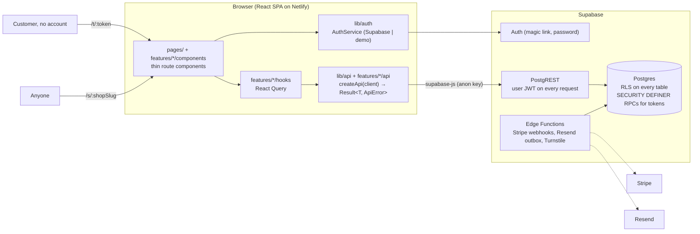

# Reel Service Tracker — app

Job tracking, customer status pages and payments for small fishing-gear service businesses
(reel techs, rod builders). This folder is the production starter: React + Vite + TypeScript +
Tailwind on the front, Supabase (Postgres, Auth, RLS) behind it, deployed on Netlify.

Phase 5a (this scaffold) is product-independent. Phase 5b adds the domain schema, the data layer
slices and the first vertical slice once the product definition is final.

## Setup

```bash
nvm use              # Node 22 (.nvmrc)
npm install
cp .env.example .env.local
npm run dev          # http://localhost:5173
```

**Demo mode.** Leave `VITE_SUPABASE_URL` and `VITE_SUPABASE_ANON_KEY` empty and the app runs with
no back end: a fake user is signed in, the data layer is in-memory, and every screen is usable.
Set both variables to point at a Supabase project and the same build talks to it. Setting one but
not the other fails at startup with a message saying so.

**SQL tests** need PostgreSQL 16 binaries and a `postgres` OS user (Debian/Ubuntu:
`apt-get install postgresql-16`). No Docker. See "Database" below.

## Scripts

| Script                 | What it does                                                       |
| ---------------------- | ------------------------------------------------------------------ |
| `npm run dev`          | Vite dev server with HMR                                           |
| `npm run build`        | Production build to `dist/`                                        |
| `npm run preview`      | Serve `dist/` locally                                              |
| `npm run lint`         | ESLint (type-aware, strict) — `lint:fix` to auto-fix               |
| `npm run format:check` | Prettier — `format` to write                                       |
| `npm run typecheck`    | `tsc -b` over the app and the Node-side configs                    |
| `npm test`             | Vitest (jsdom, Testing Library) — `test:watch`, `test:coverage`    |
| `npm run test:sql`     | Fresh local Postgres → stubs → migrations → `supabase/tests/*.sql` |
| `npm run db:types`     | Regenerate `src/lib/supabase/types.ts` from the migrations         |
| `npm run check`        | lint + format:check + typecheck + test + build (what CI runs)      |

## Architecture



Three kinds of visitor, three route groups (`src/app/router.tsx`):

| Route                           | Who                    | Layout         | Auth                                  |
| ------------------------------- | ---------------------- | -------------- | ------------------------------------- |
| `/app/*`                        | shop members           | `AppLayout`    | `ProtectedRoute` → `/login` if out    |
| `/s/:shopSlug`                  | anyone (indexable)     | `PublicLayout` | none; RLS exposes public shop columns |
| `/t/:token`                     | a customer with a link | `PublicLayout` | none; token-scoped RPC (ADR 0003)     |
| `/`, `/login`, `/auth/callback` | everyone               | `RootLayout`   | —                                     |

Rules the lint config enforces: only `src/lib/supabase/client.ts`, `src/lib/api`, `src/lib/auth`
and `src/features/*/api` may import Supabase; screens use `useApi()` and `useAuth()`. No `any`
without a `// any: reason`. No `alert`/`confirm`/`prompt`.

## Folder conventions

```
src/
  main.tsx                 mounts <App/>
  app/                     App, router, Providers (React Query, Api, Auth), layouts/
  components/              shared UI: Button, Input, Field, Spinner, EmptyState, ErrorState, PageHeader, Badge
  features/<feature>/      api/ components/ hooks/ types.ts schemas.ts index.ts (see features/shop/README.md)
  lib/
    env.ts                 Zod-validated import.meta.env; `isDemo`
    supabase/              client.ts (created once), types.ts (GENERATED)
    api/                   Result/ApiError, run() for PostgREST, error mapping, createApi(), useApi()
    auth/                  AuthService (Supabase + demo), AuthProvider, useAuth(), ProtectedRoute
    query/                 createQueryClient(), queryKeys
  pages/                   one thin component per route
  test/                    setup.ts, render.tsx (renderWithProviders)
supabase/                  config.toml, migrations/, seed.sql, tests/ (see supabase/README.md)
```

Every data-driven view renders loading, empty and error states (`Spinner`, `EmptyState`,
`ErrorState`); `AppHome`, `ShopPublicPage` and `StatusPage` show the pattern.

## How to add a feature

The step-by-step is in [`src/features/shop/README.md`](src/features/shop/README.md): migration
and SQL test → `npm run db:types` → `features/<f>/api` with a demo twin → register in
`createApi()`/`createDemoApi()` and `queryKeys` → hooks → screens with all three states → route →
tests through `renderWithProviders`.

## How to add a migration and regenerate types

1. `supabase/migrations/NNNN_name.sql` — RLS on, policies, indexes on FKs, `updated_at` trigger,
   revoke-then-grant (details and an RLS test template in `supabase/README.md`).
2. `supabase/tests/NNNN_name.sql` asserting what each role can and cannot do.
3. `npm run test:sql`
4. `npm run db:types` and commit `src/lib/supabase/types.ts` (CI fails if it is stale).

## How to run the SQL tests

`npm run test:sql` recreates a throwaway cluster under `/tmp/fishing-pg` (port 54329, as the
`postgres` OS user), applies `supabase/tests/supabase_stubs.sql` (Supabase roles, `auth.uid()`,
`storage`), the migrations and the `test.*` helpers, then runs each `supabase/tests/*.sql` file in
a rolled-back transaction. With `DATABASE_URL` set it uses that server instead (CI does this with a
`postgres:16` service container). Design: `docs/adr/0004-local-postgres-harness.md`.

## Deploy

**Netlify.** Connect the repo; the root `netlify.toml` sets `base = "app"` and `app/netlify.toml`
has the build command, publish dir, SPA redirect and security headers (CSP allows Supabase, Stripe
and Turnstile). Set the environment variables below in Site settings → Environment variables for
production and for deploy previews. Never add a service-role key, Stripe secret or Resend key there.

**Supabase.** Create a project; copy its URL and anon key into Netlify. Push the schema with:

```bash
npx supabase@2 login
npx supabase@2 link --project-ref <ref>
npx supabase@2 db push            # applies supabase/migrations in order
```

Add the same two commands as a job in `.github/workflows/ci.yml` (on `main`, after the tests) with
`SUPABASE_ACCESS_TOKEN` and `SUPABASE_DB_PASSWORD` as repository secrets. In the Supabase dashboard
set Auth → URL configuration: site URL = the Netlify URL, redirect URL = `<site>/auth/callback`.

## Environment variables

| Variable                  | Required | Where            | Meaning                                                    |
| ------------------------- | -------- | ---------------- | ---------------------------------------------------------- |
| `VITE_SUPABASE_URL`       | no\*     | browser (public) | Supabase project URL. Empty = demo mode.                   |
| `VITE_SUPABASE_ANON_KEY`  | no\*     | browser (public) | Supabase anon key; RLS is the security boundary.           |
| `VITE_APP_URL`            | no       | browser (public) | Public URL of this app; auth redirects. Default localhost. |
| `VITE_TURNSTILE_SITE_KEY` | no       | browser (public) | Cloudflare Turnstile site key for the public intake form.  |

\* Both or neither. Server-side secrets (service role, Stripe, Resend, Turnstile secret) live in
Supabase Edge Function secrets, never in `VITE_*` or the Netlify build environment.

## Decisions

`../docs/adr/`: 0001 stack, 0002 typed data layer, 0003 auth, tenancy and tokens, 0004 local
Postgres harness. Scaling notes: `../docs/scaling.md`.
