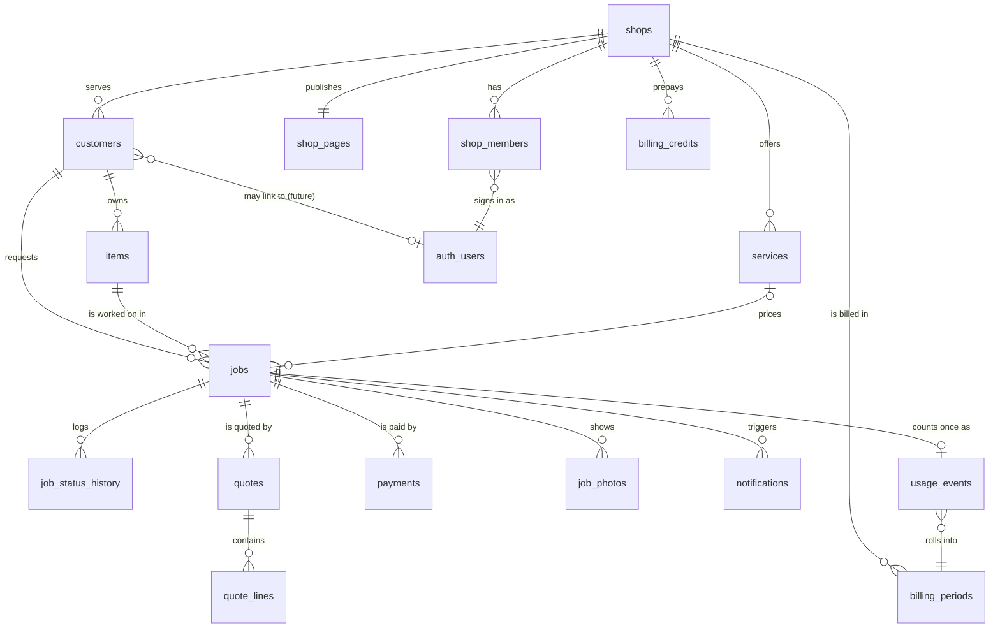

# Product definition — Bench Tag

Product Definition Agent, 2026-10-20. Input: `docs/validation-gate.md` (PASS 6/6, conditions C1–C7),
`research/evidence-repair-shop-tool.md` (V1–V54, N-V1–N-V20), `research/monetization.md` §4b–4c, §7f,
`research/hobby-immersion.md` §3.6, §3.11, `research/infrastructure-and-data.md`,
`research/gap-analysis.md` §4.1, §5, `.claude/skills/code-review-against-standards/SKILL.md`.
New facts verified today carry `PD` ids (§15); everything else cites existing ids. Decisions are
written as decisions; where a decision rests on something unverified it says `VERIFY` and names
who resolves it (§14).

---

## 1. Name and pitch

### 1a. Three names, checked

Trade-plain words only: the thing a tech puts on a reel is a *tag*; the paper the customer gets is
a *slip* or *ticket*; the place the work happens is the *bench*. No puns, nothing that says only
"reel" (C2 puts rod builds in v1).

| Name | .com (curl, 2026-10-20, PD13) | Reading |
|---|---|---|
| **Bench Tag** | `benchtag.com` resolves: 200, 114-byte registrar "lander" redirect (registered, parked, no content) | The hang tag on the reel and the status tag on the board. Says what the product is. |
| Bench Ticket | not checked separately; `tackleticket.com` is Sedo-parked, `reelticket.com` parked lander | "Repair ticket" is RepairShopr/RepairDesk vocabulary, not this trade's (P111–P113). |
| Bench Slip | `benchslip.com` does not resolve (CONNECT failed, no DNS; probably unregistered) | Plain, but "slip" collides with boat slip and slip sinker in this hobby. |

Also checked: `tacklebench.com` is a live construction-company site; `benchqueue.com`,
`reeldesk.com` parked landers; `reelqueue.com` for sale on HugeDomains; `benchorder.com` does not
resolve. None of this is a trademark or availability check (PD13).

**Pick: Bench Tag.** It names the physical object every shop already uses (dates written on the
box, V3; printed form in the box, V47; tag at drop-off, V41), it covers reels and rods, and it is two
syllables a peer can say on the phone. The .com is parked, not in use: acquiring it is a founder task
(`VERIFY`, §14 Q1); until then launch on `benchtag.app` or `getbenchtag.com` (unchecked) — the product
URL customers see is the shop's page and status link, so the root domain carries little weight at
launch.

### 1b. Pitch

Bench Tag is job tracking for the one-person reel and rod shop. A customer sends in a reel or orders
a rod from the shop's own public page and pays the deposit; the shop sees every job on one board with
a promised date; parts are quoted and approved online instead of by phone; the customer watches a
private status page and gets an email at each step; the shop sends a payment link when the work is
done and the money lands in the shop's own Stripe account. It costs $1 per job, never more than $29 a
month, and $0 in a month the shop is closed.

**Tagline:** *Every reel on the bench, every customer in the loop.*

---

## 2. Users and personas

### 2a. The tech or builder (the buyer)

One person, often part-time and seasonal (V5, V20, N-V8), 10–100 jobs a month (V3, V11), phone at
the bench with greasy hands, taking 50% deposits and parts payments by hand (V13, V22), intake by
text, call, printed form or a two-hour meeting (V2, V4, V11, V47).

- "Text or email is best. (Greasy Hands, cannot always pick up the phone.)" — Scott Rodriguez, V4
- "i've got about 60 reels in line right now." … "write the 'shipped on ....' date and the 'please
  return by ....' date on the OUTSIDE of the box." — Alan Tani, V3
- "Yes. I require a minimum 50% non-refundable deposit to accept an order for production." … "Any
  balance due must be collected before shipment or at the time delivery." — Jim Gamble, V13

What they will not do: learn a POS, pay $99/month (P§7f), hold a customer's money (V11), scale
(N-V11). What they already do: charge $15–$20 estimate fees (P67, P68), publish a price list and a
blanket turnaround (P67–P72), and run a Stripe/PayPal/Square account (V1, P70).

### 2b. The shop's customer (the end user of the status page)

An angler who left a $30–$500 reel with a shop and wants to know when it comes back, who learned the
shop's name from a forum or Facebook (V51, M20, M22) and will switch shops over silence (V40, V44).

- "they took months and I had to call them to continually get an update." — shoffer, V38
- "they blew there timeline and the kicker was that they told me my reels were ready when they
  weren't." — OldTownYakBoi, V39
- "subsequent updates on the progress were scarce." … "Despite assurances of timely communication
  upon completion, I received no further updates." — Chris, Trustpilot, V44

The positive version of the same need, which the product has to deliver: "my reels are always done
before the estimated date given at drop off." — LocoSeamonkey, V41.

### 2c. Not the target in v1

- Multi-tech shops with counters, queues and staff roles (Mike's Reel Repair with five employees,
  VS39; Haddrell's, V26): RepairDesk and Tower already serve them at $99–A$298 (GA5, VS42).
- Anyone whose problem is point-of-sale, inventory or parts stock ("hundreds of thousands of parts",
  V24; M21, M39): we track jobs, not stock.
- Marketplaces and directories: no bidding, no reviews, no cross-shop search beyond each shop's own
  indexable page (C7 absorbs candidate i only as the shop's own front door).
- OEM service centres with ticketing systems (P75–P79), and anglers as paying users (candidate d
  comes later as a consumer-owned record, gap-analysis §5).

---

## 3. Problem statement and jobs to be done

**Problem.** A one-person fishing-gear service business runs intake, the queue, approvals, status
and money through phone calls, texts, dates on boxes, printed forms and hand-raised invoices. The
tech loses time to "where's my reel?" calls, loses money to no-pays and abandoned work, and loses
customers to silence. Nothing fishing-specific exists in the US; generic tools cost 3–5× what the
shop grosses per job and cannot express a multi-week job (V1, P§7f, VS60).

| # | Job to be done (as the user would say it) | Quote ids |
|---|---|---|
| J1 | "Let people send me work without calling me." | V2, V4, V23, V47, V51, M1 |
| J2 | "Make the customer serious before I order anything." | V6, V10, V12, V13, V15, V17, V22 |
| J3 | "Know what's on the bench and what I promised, without reading boxes." | V3, V11, V27, V30, V39, V41 |
| J4 | "Stop answering 'where is it' — in both directions." | V7, V34, V38, V44, V45, V46, V52 |
| J5 | "Get a yes on parts in writing before I do the work." | V4, V21, V22, V28, V54, S13 |
| J6 | "Get paid before it leaves, without cheques." | V3, V7, V8, V22, P72 |
| J7 | "Remember this customer and this reel next time." | V10, V12, V8, V9, M48, M27 |
| J8 | "Be found by the next angler who asks 'who fixes reels near me?'" | M20, M22, M25, V35, V36, V50, V51 (C7) |

---

## 4. Feature set

### 4a. MVP (13 features)

Every row is required for the founder's shop to run on it and for a peer to pay $1 a job. Pain rows
are from evidence §1; conditions from gate §7.

| # | Feature | User story | Acceptance criteria | Pain rows | Condition |
|---|---|---|---|---|---|
| F1 | Shop account and onboarding wizard | As a tech I set up my shop in 15 minutes on my phone. | Sign up by email; wizard: shop profile (name, city, timezone, phone, mail-in/drop-off, hours), services menu (name, price or "quoted", deposit, turnaround days), deposit and uncollected-item policy text, card on file for Bench Tag billing; progress saved per step; wizard resumable. | V21–V23, P67–P72 | C1, C7 |
| F2 | Stripe Connect onboarding | As a tech I connect my own Stripe account so deposits and payments go straight to me. | "Connect Stripe" opens Stripe-hosted onboarding (Account Links); app shows `charges_enabled`; until enabled, intake works without deposits and payment links are hidden; disconnect handled (`account.application.deauthorized`). | V6, V7, V22 | C4 |
| F3 | Public shop page | As an angler I find the shop, its prices and turnaround, and send my reel. | `/s/:slug` server-rendered HTML, indexable, LocalBusiness JSON-LD, services with prices, turnaround, mail-in instructions, "Powered by Bench Tag" link; `/s/:slug/find` to recover a lost status link. | M20, M22, V47, V52 | C7 |
| F4 | Public request form | As an angler I describe my reel or order a rod, give contact details and pay the deposit. | Form (kind, brand, model, serial, problem or build spec, name, email, phone, return method); Turnstile; rate-limited; creates customer+item+job at `requested`; if the service has a deposit, redirects to Stripe Checkout on the shop's account; confirmation email with status link. No file upload from anonymous users. | V1, V2, V13, V25, V31 | C2, C4 |
| F5 | Counter intake | As a tech I log a drop-off in under 60 seconds on my phone. | `/app/jobs/new`: pick/create customer by phone or email, item, service(s), problem, promised date defaulted from turnaround, deposit (none / estimate fee / %), camera photo; creates job at `received`; emails the customer the status link; "Add another item for this customer" repeats with customer prefilled. | V3, V36, V47 | C1 |
| F6 | Job board | As a tech I see every open job by status with its promised date and what's overdue. | `/app` and `/app/jobs`: columns or filter chips by status, promised-date sort, overdue badge, search by customer/brand/job number; status change in two taps; every change logged. | V3, V11, V39, V41 | — |
| F7 | Customer status page and automatic emails | As an angler I open one link and know where my reel is, with an email at each step. | `/t/:token` (≥128-bit token, hashed at rest) shows item, status label, promised date, history, quote (if any), balance and Pay button, shop contact, customer-visible photos; emails per §5; `noindex`. | V34, V38, V44, V45, V7, V4 | C3 |
| F8 | Quote and approve | As a tech I send a parts/labour quote and get a yes or no in writing. | Quote with lines (labour, part, shipping, fee, discount), note, optional expiry; customer approves/declines on the status page (no login); shop may record a phone approval "on behalf"; revised quote supersedes; emails to both sides. | V4, V21, V22, V28, V54 | — |
| F9 | Payment link at completion | As a tech I send "ready — pay here" and the item leaves when it's paid. | Balance = service price + approved quote − deposits − payments; "Send payment link" email; Checkout on the shop's Stripe account; optional "$1.00 online service fee" line when the shop enables pass-through; "Mark paid (cash/check)" alternative; receipts; closing a job with a balance needs an explicit override. | V7, V8, V3, V22, V47 | C1, C4 |
| F10 | Pickup, shipping and uncollected items | As a tech I close the job with pickup or tracking, and the system chases uncollected items for me. | Close as picked up / shipped (carrier + tracking emailed) / returned unrepaired / abandoned; reminders at ready+7 and ready+30 days; final notice at the shop's configured day (default 90); uncollected list in the app. | V8, V9, V12, S13 | — |
| F11 | Customers, items and history | As a tech I see what I did to this reel last time and who still owes me. | Customer page: contact, items, every job with dates, amounts, notes; item page: full service history; global search by name, phone, email, serial, job number. | V10, V12, M48, M27 | — |
| F12 | Metered billing | As a tech I pay $1 per job, never more than $29 a month, nothing when closed, with one invoice a month. | Usage counted when a job reaches `received`; cap 2,900¢; no invoice for a zero month; optional $290/yr prepay credit; invoice on the 1st; failed card → emails, retries, read-only after 14 days; `/app/billing` shows this month's count and past invoices. | P67, P68, N-V8, P§9 | C1, C6 |
| F13 | Your data is yours | As a tech I can take everything out as CSV and delete my account. | Export customers, items, jobs, quotes, payments as CSV from `/app/settings`; delete shop = 30-day soft delete, then purge including photos. | gate §5 (exportable data) | — |

### 4b. v1.1 (soon after; no schema breaks required)

Multi-item tickets (one drop-off, three reels: `jobs.group_id` exists from day one, UI later); staff
logins for the shop (schema has `shop_members.role`); in-app refunds (MVP uses the Stripe Dashboard);
printable QR hang tag at intake; promised-date suggestion from queue depth; custom domain per shop
page; quote templates ("standard parts list for a Penn 525"); customer-visible progress photo
gallery per job (MVP shows photos the shop flags as visible, no gallery UI); bulk status updates
("all five of these are waiting for parts"); SMS as an opt-in, pass-through add-on after 10DLC fees
are verified (C3, GA3).

### 4c. Explicitly out of scope

SMS in the MVP (C3); a consumer gear record or angler accounts (candidate d: `customers.user_id`
is reserved, nothing is built); parts inventory or ordering; POS, cash drawer, line spooling sales;
multi-location shops; any directory, search, ranking or marketplace across shops beyond each shop's
own page (C7); accounting sync (QuickBooks, Xero); native apps (the web app is installable, nothing
more); any AI feature; warranty or OEM workflows; scheduling/appointments; estimates import; tax
calculation on the shop's own invoices (Stripe Tax can be switched on per connected account later).

---

## 5. Core flows

Email notation: **template** — *Subject* — one-line body. Sender for customer emails is
"{Shop name} via Bench Tag <updates@mail.benchtag…>" with `Reply-To` the shop's email; sender for
shop emails is "Bench Tag <hello@…>". Every customer email contains the status link; nothing else
is required to act.

### 5a. Shop onboarding

1. `/signup`: email → magic link + 6-digit code (§7). **shop_welcome** — *Welcome to Bench Tag —
   let's set up {Shop}* — "Three steps: your shop, your services, your Stripe. Resume any time."
2. `/app/onboarding` step 1 Shop: name, slug (editable once, then fixed), city/state, timezone,
   phone, public email, mail-in / drop-off, hours text, mailing address for mail-ins.
3. Step 2 Services: starts from a seed list by kind (reel: "Spinning reel service", "Conventional /
   lever-drag service", "Repair — quoted after inspection", "Estimate fee"; rod: "Guide or tip
   replacement", "Custom rod build — quoted", "Rod repair — quoted"); each has price (or "quoted"),
   "from" flag, deposit (none / fixed / %; rod builds default 50%), turnaround days, active. Mirrors
   the real menus in P67–P72 and the founder's own list (P3–P5).
4. Step 3 Policies: deposit wording, uncollected-item days and wording (defaults: 90 days; V8 120,
   V9 21, S13 90), return shipping flat fee, whether to pass the $1 fee to customers.
5. Step 4 Billing card: Stripe Checkout `mode=setup` on the platform account; stored as
   `shops.stripe_customer_id`. Required before the first job unless `billing_exempt` (founder).
6. Step 5 Connect Stripe: `stripe-connect-onboard` creates the account (controller properties =
   Standard behaviour, §9) and an Account Link; return → poll `charges_enabled`. Can be skipped and
   finished later; without it, deposits and payment links are off and the page says "pay at pickup".
7. Publish: `/app/page` preview → "Publish". **page_live** — *Your page is live: {url}* — "Put this
   link on your Facebook page, your boxes and your hang tags."

### 5b. Customer intake via the public page

1. `/s/:slug` (server-rendered) → "Send us your reel" / "Order a rod" → `/s/:slug/request`.
2. Form fields: kind (reel | rod), service (from the shop's active menu for that kind), brand, model,
   serial (optional), problem / build spec (textarea), first name, last name, email, phone
   (optional), return method (pickup | ship back), consent line. Cloudflare Turnstile widget.
3. POST to Edge Function `public-intake`: Turnstile siteverify; rate limit (per IP: 5/hour per shop;
   per email: 3/day); Zod; upsert customer by (shop, lower(email)); insert item, job at `requested`
   with `source='public_page'`, token generated; **intake_received** — *{Shop} got your request — your
   tracking link* — "We'll confirm when your {Penn Spinfisher} arrives. Track it here any time."
   Shop gets **new_request** — *New request: {kind} {brand} {model} from {First}* — "Open it in Bench
   Tag." If the service carries a deposit: create Checkout Session (direct charge on the shop's
   account, `payment_intent_data.metadata.job_id`) and return its URL → redirect. Else return the
   status URL.
4. Deposit paid (webhook): payments row `succeeded`; rod kind → system transition `requested →
   received` ("Order confirmed"); **deposit_paid** — *Deposit received — your rod order is
   confirmed* — "{Shop} will start when the blank arrives; promised by {date}." Reel kind stays
   `requested` until the shop marks it received.
5. Anti-spam decision: **Cloudflare Turnstile.** Free plan: up to 20 widgets, 10 hostnames per
   widget, unlimited challenges, usable without routing traffic through Cloudflare (PD11). One widget
   covers every shop page because all pages live on the product's hostname; a custom-domain feature
   later needs more hostnames (§14 Q7). hCaptcha was not verified and shows picture puzzles, which
   fail the accessibility target in §13.
6. Unhappy: Turnstile fails → form error, no row. Rate limit hit → 429 with plain text "Too many
   requests from this network; try again in an hour or call the shop." Deposit Checkout abandoned →
   job stays `requested`; **deposit_reminder** at 3 days — *Finish your order with {Shop}* — "Your
   rod order is waiting for its deposit." At 14 days: system `requested → cancelled`,
   **request_expired** — *Your request with {Shop} expired* — "Nothing was charged. Start again any
   time." Reel requests older than 30 days with no item received appear in the shop's "Stale
   requests" list with one-tap cancel.

### 5c. Counter intake by the shop

`/app/jobs/new` on the phone: search customer by phone/email/name (or new); kind; brand/model/
serial (brand/model autocompleted from this shop's previous items); service(s); problem; promised
date (today + turnaround); deposit: none / estimate fee / % → "Collect now" opens Checkout on the
shop's phone for the customer to tap, or "Mark paid cash"; camera → intake photo (resized on
device). Save → job at `received`, usage event recorded, **item_received** — *{Shop} has your {item}
— promised by {date}* — "Track it here. We'll email you if anything changes." No deposit path: same
email. A "Pay at pickup" shop with no Stripe sees no payment steps.

### 5d. Job lifecycle

**One enum, one board, one history table; the item's `kind` selects labels and the allowed moves.**
Two enums would double the status page component, the transition table, the RLS tests and the
email templates for a flow that differs in three labels and one skipped step. Money is not a
status: "paid" is a badge computed from `payments`, because a rod can be paid in full before it is
ready and a reel can be picked up unpaid by the shop's choice (V18). The gate's draft list
(`paid`, `balance_paid`, `deposit_paid`, `shipped/picked_up`) becomes: payment facts on the job, and
`closed` with a `closed_how` reason.

```
job_status: requested | received | diagnosing | quote_sent | approved | declined |
            in_progress | waiting_parts | finishing | ready | closed | cancelled
closed_how: picked_up | shipped | returned_unrepaired | abandoned | other
```

Labels (shop / customer), by kind:

| status | reel | rod build |
|---|---|---|
| requested | Requested / Request received | Order placed / Waiting for your deposit |
| received | Received / We have your reel | Order confirmed / Your order is confirmed |
| diagnosing | Diagnosing / Being looked at | — (not allowed) |
| quote_sent | Quote sent / Waiting for your approval | Change quoted / Waiting for your approval |
| approved | Approved / Approved, in the queue | same |
| declined | Declined / You declined the quote | same |
| in_progress | On the bench / Being serviced | Building / Being built |
| waiting_parts | Waiting for parts / Waiting for parts | Components ordered / Blank and components ordered |
| finishing | Final assembly and test / Almost done | Wrapping and finishing / Wrapping and finishing |
| ready | Ready / Ready for pickup · Ready to ship | same |
| closed | Closed / Picked up · Shipped · Returned | same |
| cancelled | Cancelled / Cancelled | same |

Allowed transitions (seeded in `job_status_transitions`, enforced by `transition_job()`; `*` = both
kinds, `reel`/`rod` = that kind only):

```
requested     → received*, cancelled*
received      → diagnosing(reel), quote_sent*, in_progress*, waiting_parts*, ready*, cancelled*
diagnosing    → quote_sent, in_progress, waiting_parts, ready, cancelled        (reel)
quote_sent    → approved*, declined*, quote_sent* (revision), cancelled*
approved      → in_progress*, waiting_parts*
declined      → ready* (return unrepaired), cancelled*
in_progress   → waiting_parts*, finishing*, ready*, quote_sent* (found more work)
waiting_parts → in_progress*, finishing*, quote_sent*
finishing     → ready*, in_progress*
ready         → closed*, in_progress* (rework before it left)
closed, cancelled: terminal (a comeback is a new job on the same item)
```

Default reel path: received → diagnosing → quote_sent → approved → in_progress → ready → closed.
Default rod path: requested →(deposit)→ received → waiting_parts → in_progress → finishing → ready →
closed. Skipping is allowed wherever an arrow exists; the board offers the next default step as the
big button and the rest behind "Other".

Emails on transitions (customer): **status_update** — *Update on your {item}: {customer label}* —
"{optional note from the shop}. Promised by {date}." Sent for in_progress, waiting_parts, finishing,
and for a promised-date change (**promised_date_changed** — *New promised date for your {item}:
{date}* — "{note}"). Not sent for received→diagnosing (noise). **ready_pickup** — *Your {item} is
ready at {Shop}* — "Balance due ${x}. Pay now or at pickup." / **ready_ship** — *Your {item} is ready
to ship* — "Pay ${x} and it goes out with tracking." **shipped** — *Your {item} is on its way* —
"{Carrier} {tracking}." **closed_pickup** — *Thanks from {Shop}* — "Your {item} was picked up on
{date}; here's your service record." A free-text "Send an update" writes a history row with the same
status and sends **status_update**.

### 5e. Quote and approval

1. `/app/jobs/:id` → "Quote": lines (kind, description, qty, unit price), note, expiry (default 14
   days) → "Send": quote `sent`, job → `quote_sent`. **quote_sent** — *Quote from {Shop} for your
   {item}: ${total}* — "Approve or decline with one tap; work starts after approval."
2. Customer on `/t/:token`: sees lines and totals → Approve (optional note) or Decline (optional
   reason). RPC `decide_quote_by_token`. Approve → quote `approved`, job → `approved`;
   **quote_decided_shop** — *{First} approved your quote for #{n} (${total})* — "Next: order parts or
   start." Decline → job → `declined`; shop email *…declined…* — "Return it unrepaired or cancel."
3. Shop may record "approved by phone/in person" → `decided_via='shop_on_behalf'`, logged.
4. Revision: a new quote version supersedes the old (`superseded`); customer sees only the current.
   **quote_reminder** at 3 days unanswered — *Still waiting on your decision for your {item}* — "The
   quote expires {date}."
5. Parts prepaid before work (V22): a quote may be flagged `collect_on_approval`; approval redirects
   to Checkout for the quote total; the job moves to `approved` only when the payment succeeds.

### 5f. Completion and payment link

Balance = service price (from the job's service, or 0 if "quoted") + approved quote total +
return-shipping fee (if ship) + online service fee (if enabled, once) − deposits − payments. "Mark
ready" asks pickup or ship, shows the balance, and sends **ready_pickup**/**ready_ship** with a Pay
button. Pay → Edge Function `create-checkout` (token mode) → Checkout on the shop's account with
line items: "{Service} — {item}", "Parts and labour (quote #{n})", "Return shipping", and, when
`shops.pass_fee_to_customer` is on and `jobs.service_fee_charged_at` is null, "Online service fee
$1.00". Success → webhook → payments `succeeded`, `service_fee_charged_at` set; shop gets
**payment_received** — *Payment received: ${amount} for #{n} {item}* — "Paid in full; ready to go
out." Stripe sends the customer the card receipt (connected-account branding). "Mark paid
(cash/check)" records a `payments` row with `method` and no Stripe ids. Closing with a balance needs
"Close anyway" and a reason (logged).

### 5g. Pickup and shipping

Picked up → `closed(picked_up)`. Ship → carrier, tracking → `closed(shipped)` → **shipped**.
Returned unrepaired (after a decline) → `closed(returned_unrepaired)`; a diagnostic fee, if the
shop's service menu has one, is on the balance.

### 5h. History and search

`/app/customers/:id` lists items and jobs; `/app/items/:id` (reached from a job or customer) is the
service record; `/app/jobs?q=` searches job number, customer name/phone/email, brand, model, serial.
Closed jobs are kept forever unless the shop deletes the customer.

### 5i. Unhappy paths

| Case | Behaviour |
|---|---|
| Declined quote | §5e; item goes back via `ready` → `closed(returned_unrepaired)` with any diagnostic fee due; **declined_next_steps** — *You declined the quote — what happens next* — "We'll have your {item} ready to collect; {fee line if any}." |
| Uncollected item | Hourly cron `flag_uncollected()`: ready+7d **pickup_reminder** — *Reminder: your {item} is waiting at {Shop}*; ready+30d second reminder; ready+`shops.uncollected_days` **uncollected_final** — *Final notice about your {item} at {Shop}* — "{shop's policy text}." Shop sees "Uncollected" list and may close as `abandoned` (note required). Policy text appears on the public page and in **item_received**. |
| Refund | MVP: the shop refunds from its own Stripe Dashboard (Standard accounts have the full Dashboard, PD2). Webhook `charge.refunded` → `payments.refunded_cents`, status `refunded`/`partially_refunded`; **refund_issued** — *Refund of ${x} from {Shop}* — "It will show on your card in 5–10 days." In-app refund button is v1.1. |
| Customer lost the email | `/s/:slug/find`: email + Turnstile → `public-find-job` rotates the token on each open job for that email and sends **links_resent** — *Your tracking links from {Shop}* — "Older links no longer work." Response is the same whether or not the email exists. Shop can also "Resend link" from the job (same rotation). |
| Card declined on completion | Nothing recorded until Checkout succeeds; Checkout handles retries; a `pending` payments row with the session id is reused for 24h so two tabs cannot pay twice. |
| Shop disconnects Stripe | `account.application.deauthorized` → `charges_enabled=false`; payment buttons hide; shop email **stripe_disconnected** — *Stripe is disconnected — payment links are off*. |
| Shop's Bench Tag card fails | §11. |
| Customer replies to an email | `Reply-To` is the shop's email; Bench Tag never reads replies. |

---

## 6. Data model

Conventions (from the code standards): every table has `id uuid primary key default
gen_random_uuid()` unless noted, `created_at timestamptz not null default now()`, `updated_at
timestamptz not null default now()` maintained by a shared `set_updated_at()` trigger; money is
`integer` cents with `check (>= 0)` (named `*_cents`); multi-tenancy by `shop_id uuid not null
references shops(id)` on every tenant table, indexed; soft delete `deleted_at timestamptz` where
listed; all schema in numbered migrations under `app/supabase/migrations` with `seed.sql` seeding
enums' lookup rows, the service templates and a demo shop; `Database` types generated.

Enums: `item_kind (reel, rod)`, `job_status` (§5d), `closed_how` (§5d), `job_source (public_page,
counter)`, `delivery_method (pickup, ship)`, `member_role (owner, staff)`, `quote_status (draft,
sent, approved, declined, superseded, expired)`, `quote_line_kind (labor, part, shipping, fee,
discount)`, `payment_purpose (deposit, quote, balance, other)`, `payment_method (card, cash, check,
other)`, `payment_status (pending, succeeded, failed, refunded, partially_refunded, expired)`,
`notification_status (pending, sending, sent, failed, cancelled)`, `notification_template` (every
bold name in §5), `billing_status (ok, past_due, read_only)`, `billing_period_status (open,
closed, invoiced, paid, void)`, `credit_source (prepay, promo, adjustment)`, `photo_kind (intake,
progress, finished, quote)`, `actor_kind (shop, customer, system)`.

| Table | Columns (type, constraint, default) | Indexes / notes |
|---|---|---|
| `shops` | `slug citext unique check (slug ~ '^[a-z0-9](?:[a-z0-9-]{1,38}[a-z0-9])$')`; `name text not null`; `public_email citext`; `phone text`; `address_line1/2 text`, `city text`, `region text`, `postal_code text`, `country char(2) default 'US'`; `timezone text not null default 'America/New_York'`; `currency char(3) not null default 'usd'`; `logo_path text`; `accepts_mail_in bool default true`; `accepts_drop_off bool default true`; `hours_text text`; `deposit_policy_text text`; `uncollected_days int not null default 90 check (between 7 and 365)`; `uncollected_policy_text text`; `return_shipping_cents int default 0`; `pass_fee_to_customer bool not null default false`; `stripe_account_id text unique`; `stripe_charges_enabled bool not null default false`; `stripe_details_submitted bool not null default false`; `stripe_customer_id text unique` (platform billing); `billing_status billing_status not null default 'ok'`; `billing_exempt bool not null default false`; `next_job_number int not null default 1`; `onboarding_step smallint not null default 1`; `published_at timestamptz`; `deleted_at` | `billing_exempt` settable only by service role (column-level revoke from authenticated). |
| `shop_members` | `shop_id`, `user_id uuid references auth.users on delete cascade`, `role member_role not null default 'owner'`; pk `(shop_id, user_id)` | idx `user_id`. Inserted only by `create_shop()`; v1 one owner per shop. |
| `shop_pages` | `shop_id pk references shops`; `headline text`; `intro text`; `mail_in_instructions text`; `drop_off_instructions text`; `show_prices bool default true`; `show_turnaround bool default true`; `hero_photo_path text`; `meta_description text check (length <= 160)`; `published bool default false` | One row per shop, created by `create_shop()`. |
| `services` | `shop_id`; `kind item_kind not null`; `category text not null default 'Service'`; `name text not null`; `description text`; `price_cents int` (null = quoted after inspection); `price_is_from bool default false`; `deposit_pct smallint check (between 0 and 100)`; `deposit_cents int`; `turnaround_days int check (between 0 and 365)`; `is_estimate_fee bool default false`; `active bool default true`; `sort_order int default 0` | idx `(shop_id, kind, active)`; check: not both `deposit_pct` and `deposit_cents`. |
| `customers` | `shop_id`; `first_name text not null`; `last_name text`; `email citext`; `phone text`; `notes text`; `ship_address jsonb`; `user_id uuid references auth.users` (nullable; future consumer link); `deleted_at` | unique `(shop_id, email) where email is not null and deleted_at is null`; idx `(shop_id, phone)`; GIN trigram on `first_name || last_name` for search. |
| `items` | `shop_id`; `customer_id references customers`; `kind item_kind not null`; `brand text`; `model text`; `serial text`; `description text`; `deleted_at` | idx `customer_id`, `(shop_id, serial)`, trigram on `brand || model`. For a rod order the item is the rod to be built (blank maker/model in brand/model, spec in description). |
| `jobs` | `shop_id`; `customer_id`; `item_id`; `service_id references services` (nullable); `kind item_kind not null` (copied from item); `job_number int not null`; `group_id uuid` (reserved, multi-item tickets); `source job_source not null`; `status job_status not null default 'requested'`; `problem text`; `shop_notes text`; `promised_date date`; `delivery delivery_method`; `ship_to jsonb`; `carrier text`; `tracking_number text`; `received_at`, `ready_at`, `closed_at timestamptz`; `closed_how closed_how`; `closed_note text`; `token_hash bytea not null unique`; `token_rotated_at timestamptz`; `deposit_due_cents int default 0`; `service_price_cents int default 0`; `service_fee_charged_at timestamptz`; `created_by uuid references auth.users` (null for public); `deleted_at` | unique `(shop_id, job_number)`; idx `(shop_id, status)`, `(shop_id, promised_date)`, `(shop_id, created_at desc)`, `customer_id`, `item_id`. `job_number` from `shops.next_job_number` inside `create_job()`. |
| `job_status_transitions` | `kind item_kind`, `from_status`, `to_status`; pk `(kind, from_status, to_status)` | Seeded from §5d (rows duplicated per kind); read by `transition_job()`. |
| `job_status_history` | `id bigint generated always as identity pk`; `job_id`; `shop_id`; `from_status job_status`; `to_status job_status not null`; `actor actor_kind not null`; `actor_user_id uuid`; `note text`; `customer_visible bool default false`; `created_at` | idx `(job_id, created_at)`. Append-only (no update/delete policies). |
| `quotes` | `shop_id`; `job_id`; `version int not null`; `status quote_status not null default 'draft'`; `note_to_customer text`; `collect_on_approval bool default false`; `subtotal_cents int not null default 0`; `total_cents int not null default 0`; `sent_at`, `decided_at`, `expires_at timestamptz`; `decided_via text check (in ('token_page','shop_on_behalf'))`; `decision_note text` | unique `(job_id, version)`; idx `job_id`. Totals recomputed by trigger from lines. |
| `quote_lines` | `quote_id`; `kind quote_line_kind not null`; `description text not null`; `qty numeric(8,2) not null default 1 check (> 0)`; `unit_cents int not null`; `total_cents int generated always as (round(qty * unit_cents)) stored`; `sort_order int` | idx `quote_id`. Discount lines carry negative `unit_cents` (the only signed money column; check elsewhere). |
| `payments` | `shop_id`; `job_id`; `purpose payment_purpose not null`; `method payment_method not null`; `status payment_status not null default 'pending'`; `amount_cents int not null`; `fee_line_cents int not null default 0`; `refunded_cents int not null default 0`; `currency char(3) default 'usd'`; `stripe_checkout_session_id text unique`; `stripe_payment_intent_id text unique`; `stripe_charge_id text`; `recorded_by uuid`; `paid_at timestamptz`; `note text` | idx `job_id`, `(shop_id, paid_at)`. View `job_balances` sums per job. |
| `job_photos` | `shop_id`; `job_id`; `kind photo_kind not null`; `bucket text not null check (in ('job-photos','job-photos-shared'))`; `storage_path text not null unique`; `caption text`; `customer_visible bool not null default false`; `width int`, `height int`, `bytes int`; `uploaded_by uuid` | idx `job_id`. `customer_visible` is true iff bucket is the shared one (check). |
| `notifications` | `shop_id`; `job_id` (nullable); `template notification_template not null`; `to_email citext not null`; `subject text not null`; `payload jsonb not null default '{}'`; `status notification_status not null default 'pending'`; `attempts int not null default 0`; `next_attempt_at timestamptz not null default now()`; `last_error text`; `provider_message_id text`; `sent_at timestamptz`; `dedupe_key text unique` | idx `(status, next_attempt_at) where status in ('pending','failed')`. The outbox; nothing sends email except the worker that drains it. |
| `usage_events` | `shop_id`; `job_id unique`; `occurred_at timestamptz not null`; `period_month date not null` (first of month in the shop's timezone); `billable bool not null default true`; `void_reason text`; `voided_at timestamptz` | idx `(shop_id, period_month)`. One row per job for life: counting twice is impossible. |
| `billing_periods` | `shop_id`; `period_month date not null`; `status billing_period_status not null default 'open'`; `jobs_counted int not null default 0`; `gross_cents int not null default 0`; `capped_cents int not null default 0`; `credit_applied_cents int not null default 0`; `due_cents int not null default 0`; `stripe_invoice_id text unique`; `hosted_invoice_url text`; `closed_at`, `invoiced_at`, `paid_at timestamptz`; `failed_attempts int default 0`; `last_failure_at timestamptz` | unique `(shop_id, period_month)`. Created lazily by the first usage event of the month, so an idle month has no row. |
| `billing_credits` | `shop_id`; `source credit_source not null`; `amount_cents int not null`; `remaining_cents int not null`; `stripe_payment_intent_id text unique`; `starts_at timestamptz not null default now()`; `expires_at timestamptz not null` | idx `(shop_id, expires_at)`. Prepay = 29,000¢ expiring in 12 months. |
| `stripe_events` | `id text pk` (evt_…); `type text not null`; `account text`; `livemode bool`; `received_at timestamptz default now()`; `processed_at timestamptz`; `error text` | Idempotency for both webhook endpoints. |
| `rate_limits` | `key text`; `window_start timestamptz`; `count int`; pk `(key, window_start)` | Keys like `intake:ip:<sha256>`, `intake:email:<sha256>`, `find:email:<sha256>`; cron purges rows older than 2 days. |

Views: `job_balances` (job_id, deposits_cents, paid_cents, quote_cents, balance_cents) with
`security_invoker = true`; `shop_month_usage` for `/app/billing`.



Reserved for the future, costing nothing now: `customers.user_id`, `jobs.group_id`,
`shop_members.role`, `job_photos.kind`.

---

## 7. Auth and access

### 7a. Shop members

Supabase Auth, email provider, **magic link with a 6-digit code as the default; password optional.**
The email template carries both `{{ .ConfirmationURL }}` and `{{ .Token }}` so the person taps the
link if it opens in the same browser or types the code if it does not (the common failure on phones
where the mail app opens an in-app browser). Why not password-first: the buyer signs in a few times
a season from a phone at a bench; forgotten passwords are the first support ticket for seasonal
tools and the email channel already exists. A password can be set in `/app/settings` for people who
want one. Auth emails go out through Resend as Supabase's custom SMTP so deliverability and sender
reputation are one problem, not two. Sessions: default refresh-token rotation; "remember this
phone" is the default.

### 7b. Customers: unauthenticated, by token

Decision: **(a) a `SECURITY DEFINER` RPC**, `job_by_token(p_token text) returns jsonb`, plus
`decide_quote_by_token(...)`, both callable by `anon`; no anon policies on any table.

- Token: 16 bytes from `gen_random_bytes(16)`, base64url, 22 characters → 128 bits of entropy.
  Stored only as `jobs.token_hash = sha256(token)`; the raw token appears in the create response
  (once, for the app to show/print) and in emails. A leaked table or backup exposes no live links.
  "Resend link" rotates the token.
- Projection: shop (name, slug, phone, public email, logo), item (kind, brand, model), job (number,
  status, labels resolved client-side, promised date, delivery, tracking), customer-visible history
  rows, current quote with lines, balance from `job_balances`, customer-visible photo URLs (public
  shared bucket), `pay_enabled`. Never: internal notes, other jobs, customer PII beyond first name,
  Stripe ids.
- Rate limiting and brute force: 2^128 makes enumeration infeasible, so correctness rests on the
  entropy, not the limiter. The RPC still records lookups with no match in `rate_limits`
  (`token_miss:<minute>`) and the daily ops digest reports misses so a scanner is visible. PostgREST
  exposes no client IP to SQL, which is the one thing (b) would add; it is not worth a second hop
  and cold starts on the page customers open most.
- Why not (b) an Edge Function for reads: adds latency and a second codebase path for the same
  projection; the function would call the same RPC anyway. (b) is used where a secret is needed
  (Stripe Checkout creation, Turnstile).
- Why not (c) RLS on an anon-readable view: PostgREST filters are chosen by the client, so an anon
  `select ... where token = eq.X` policy leaks the moment the policy is wrong, and there is no way
  to bind the token to the request short of a custom header read in the policy. It is the pattern
  that produces the headline leaks.

### 7c. RLS policy matrix (plain English)

Helper: `is_shop_member(shop_id)` = exists in `shop_members` for `auth.uid()`; `is_shop_owner`
likewise with role. Every table has RLS enabled. No table grants to `anon` beyond `execute` on the
three public RPCs and `public_shop(slug)`.

| Table | Shop member (authenticated) | Anon via token/slug RPC | Service role (edge functions, cron) |
|---|---|---|---|
| shops | select/update own shop (not `billing_exempt`, `stripe_*`, `billing_status`: column grants revoked; updated by RPC/service only); no insert (RPC `create_shop`), no delete (RPC soft-delete) | `public_shop(slug)` returns the public projection of a published shop | all |
| shop_members | select rows for own shops; no insert/update/delete in v1 (RPC) | — | all |
| shop_pages | select/update own | via `public_shop` | all |
| services | select/insert/update own; delete only if no jobs reference it (else `active=false`) | via `public_shop` (active only) | all |
| customers | select/insert/update/soft-delete own | first name only, via `job_by_token` | all (intake upsert) |
| items | select/insert/update/soft-delete own | kind/brand/model via `job_by_token` | all |
| jobs | select own; insert via `create_job()` only; update own except `status`, `token_hash`, `job_number`, `service_fee_charged_at` (changed only through RPCs); no delete (soft via RPC) | projection via `job_by_token`; status change only through `decide_quote_by_token` | all (intake, webhooks, cron) |
| job_status_transitions | select | — | all (seed) |
| job_status_history | select own; insert via `transition_job()`; no update/delete | customer-visible rows via RPC | all |
| quotes, quote_lines | select/insert/update own while `draft`; `send_quote()` RPC moves to sent; no delete after sent | current quote via RPC; decision via RPC | all |
| payments | select own; insert only `method <> 'card'` via `record_offline_payment()`; no update/delete | balance via RPC | all (webhooks) |
| job_photos | select/insert/delete own (storage policy mirrors) | shared-bucket URLs via RPC | all |
| notifications | select own (sent log in the job timeline); no insert/update/delete | — | all (queued by triggers/RPCs with `security definer`; drained by worker) |
| usage_events, billing_periods, billing_credits | select own; no writes | — | all |
| stripe_events, rate_limits | none | — | all |

Tests: `app/supabase/tests/rls.sql` must prove, for two shops A and B, that A cannot read or write
any B row in every table above, that anon can read nothing without a valid token, that a wrong token
returns null, and that `decide_quote_by_token` refuses a quote that is not `sent`. The code-review
skill blocks a merge without these.

### 7d. Storage buckets

| Bucket | Public | Path | Policies |
|---|---|---|---|
| `job-photos` | no | `<shop_id>/<job_id>/<uuid>.jpg` | insert/select/delete when `is_shop_member((storage.foldername(name))[1]::uuid)`; max 2 MB; mime image/jpeg, image/png, image/webp |
| `job-photos-shared` | yes (read by URL, no listing) | `<shop_id>/<job_id>/<uuid>.jpg` | insert/delete as above; anon read by exact path only (bucket public, listing disabled); used for photos the shop marks customer-visible — the app uploads the resized copy here |
| `shop-assets` | yes | `<shop_id>/logo.<ext>`, `hero.<ext>` | insert/update/delete by shop member; anon read |

Photos are resized on the device before upload (long edge 1600 px, JPEG q0.8, ≤300 KB target; GA9)
in `src/lib/images.ts`; the service layer refuses files over 2 MB.

---

## 8. Edge functions and background jobs

Default: Supabase Edge Functions (Deno) next to the database, service-role key in Supabase secrets
only. Netlify Functions only for the one job that needs no database write and benefits from the CDN:
rendering the public pages.

| Function | Runtime | Trigger | Inputs | Outputs / side effects | Secrets |
|---|---|---|---|---|---|
| `public-page` | Netlify Function | GET `/s/:slug`, `/s/:slug/request`, `/s/:slug/find` (netlify.toml redirects) | slug | Calls `public_shop(slug)` with the anon key, renders HTML from a template (no React): services, turnaround, instructions, JSON-LD `LocalBusiness`, canonical, "Powered by Bench Tag"; request form with the Turnstile script tag; `Cache-Control: public, s-maxage=300, stale-while-revalidate=86400`; 404 for unpublished | `SUPABASE_URL`, `SUPABASE_ANON_KEY`, `TURNSTILE_SITE_KEY` (all public-safe) |
| `public-intake` | Supabase | POST from the request form | form JSON, Turnstile token, shop slug | siteverify; `rate_limits`; Zod; upsert customer, insert item + job (`requested`); queue `intake_received` + `new_request`; if deposit: Checkout Session on the connected account (`Stripe-Account`, `metadata.job_id`, `success_url=/t/<token>?paid=1`) → `{ redirect_url }`; else `{ status_url }` | `TURNSTILE_SECRET_KEY`, `SUPABASE_SERVICE_ROLE_KEY`, `STRIPE_SECRET_KEY` |
| `public-find-job` | Supabase | POST from `/s/:slug/find` | email, Turnstile token | rate limit; rotate tokens on open jobs for that email at that shop; queue `links_resent`; always 200 | same as above |
| `stripe-connect-onboard` | Supabase | POST, member JWT | `shop_id` | Creates account if none (`controller.stripe_dashboard.type=full`, `fees.payer=account`, `losses.payments=stripe`, `requirement_collection=stripe`, i.e. Standard behaviour, PD3); Account Link (`account_onboarding`, return/refresh to `/app/settings?stripe=…`); `{ url }` | `STRIPE_SECRET_KEY`, service role |
| `create-checkout` | Supabase | POST; either token (customer) or member JWT + job_id (shop collecting at the counter) | `purpose` (deposit, quote, balance) | Computes amount from the DB (never from the client), builds line items incl. the optional $1 fee line, reuses an unexpired pending session, creates Checkout Session on the connected account; inserts `payments(pending)`; `{ url }` | `STRIPE_SECRET_KEY`, service role |
| `billing-checkout` | Supabase | POST, member JWT | `mode` (setup card, prepay) | Platform-account Checkout: `mode=setup` for the card, or `mode=payment` $290 with `metadata.shop_id` for prepay; creates `stripe_customer_id` if missing; `{ url }` | `STRIPE_SECRET_KEY`, service role |
| `stripe-webhook-connect` | Supabase | Stripe endpoint with "Events from: connected accounts" (`connect=true`, PD7) | `checkout.session.completed`, `checkout.session.async_payment_succeeded/failed`, `payment_intent.succeeded`, `charge.refunded`, `account.updated`, `account.application.deauthorized` | Verify signature; insert `stripe_events` (dup → 200, skip); payments rows by `metadata.job_id`; rod deposit → `transition_job(received, system)`; quote `collect_on_approval` → approved; `service_fee_charged_at`; refunds; `stripe_charges_enabled`; queue emails | `STRIPE_WEBHOOK_SECRET_CONNECT`, `STRIPE_SECRET_KEY`, service role |
| `stripe-webhook-platform` | Supabase | Stripe endpoint "Events from: your account" | `checkout.session.completed` (setup, prepay), `invoice.paid`, `invoice.payment_failed`, `invoice.voided` | card saved → `shops.stripe_customer_id`; prepay → `billing_credits`; invoice paid → period `paid`, `billing_status='ok'`; failed → `past_due`, `failed_attempts++`, queue `billing_card_failed` | `STRIPE_WEBHOOK_SECRET_PLATFORM`, service role |
| `send-notifications` | Supabase | pg_cron every minute → `net.http_post` with `Authorization: Bearer <CRON_SECRET>`; also invoked directly after an interactive queue insert for sub-minute delivery | none | RPC `claim_notifications(50)` (`for update skip locked`, sets `sending`); render template from `_shared/email/*.ts`; Resend `POST /emails` with `Idempotency-Key = notification.id` (keys kept 24 h, duplicates return the original id, PD10); on success `sent`; on failure `failed` with backoff 1m, 5m, 30m, 2h, 12h, 24h (6 attempts) then stays `failed` and appears in the ops digest | `RESEND_API_KEY`, `CRON_SECRET`, service role |
| `bill-shops` | Supabase | pg_cron 1st of month 12:00 UTC after `close_billing_periods()`; also daily 12:00 UTC for retries | none | For each `billing_periods` in `closed` with `due_cents > 0`: create Stripe Invoice on the platform account (customer = shop, `collection_method=charge_automatically`, `auto_advance=true`, idempotency key = period id, one line "{n} jobs in {Month} at $1.00, capped at $29.00" and a credit line if applied); finalize → `invoiced`. Daily: for `past_due` periods at days 3 and 7 call `invoices.pay`; at day 14 set `billing_status='read_only'` and queue `billing_read_only` | `STRIPE_SECRET_KEY`, `CRON_SECRET`, service role |
| `ops-digest` | SQL + notifications | pg_cron daily 11:00 UTC | none | One email to the founder: jobs created, emails sent/failed, webhook errors, token misses, read-only shops, C6 counter (§12) | — |

SQL functions (security definer where noted): `create_shop(name, slug, tz)`; `create_job(...)` (job
number, token, usage event, first history row, email) ; `transition_job(job_id, to, note,
customer_visible)` (checks `job_status_transitions`, writes history, queues the right template,
records usage on first `received`); `send_quote(quote_id)`; `record_offline_payment(job_id,
amount, method, note)`; `rotate_job_token(job_id)`; `void_job_usage(job_id, reason)` (≤7 days, no
payments); `job_by_token`, `decide_quote_by_token`, `public_shop` (anon, definer);
`claim_notifications(n)`; `close_billing_periods()`; `flag_uncollected()`; `expire_requests()`;
`purge_rate_limits()`; `purge_deleted_shops()`.

pg_cron schedule (Supabase Cron runs from every second to once a year; keep ≤8 concurrent and ≤10
minutes per job, PD12): `* * * * *` send-notifications; `0 * * * *` flag_uncollected +
expire_requests + quote reminders; `0 12 1 * *` close_billing_periods then bill-shops; `0 12 * * *`
bill-shops retries; `0 11 * * *` ops-digest; `0 3 * * *` purge_rate_limits + purge_deleted_shops.
The `CRON_SECRET` lives in Supabase Vault and is read by the cron SQL, never in a table.

Why `public-page` is on Netlify: it is pure HTTP rendering with no writes, it must sit in front of
the product domain so the CDN can cache it, and C7 needs HTML that a crawler sees without executing
the SPA. Everything that touches secrets or writes rows is on Supabase.

---

## 9. Third-party services and costs

### 9a. Mechanics decisions

**Money to the shop (C4).** Connected accounts are created with the controller properties that
equal a Standard account: full Stripe Dashboard, the connected account pays Stripe's fees, Stripe
carries negative-balance losses, Stripe collects requirements (PD3; Stripe's docs now call the
`type=standard` parameter legacy and say the default controller values "match the behavior of a
Standard account"). Charges are **direct charges** created with the `Stripe-Account` header: "The
payment appears as a charge on the connected account", "the connected account covers Stripe fees,
refunds, and chargebacks", and accounts with the full Dashboard support direct charges only (PD1,
PD2, PD4). The platform never holds a deposit.

**Can an application fee be taken on direct charges for these accounts? Yes.** The direct-charges
guide shows `payment_intent_data[application_fee_amount]` on a Checkout Session with the
`Stripe-Account` header, states "There are no additional Stripe fees on the application fee
itself", and that the fee is transferred to the platform after the charge (PD1,
https://docs.stripe.com/connect/direct-charges). **We do not use it for the platform fee.** Reasons:
(1) C1 bills per job created, and a third of jobs are paid in cash at the counter or never through
Checkout, so a fee on charges under-bills and makes revenue depend on the shop's payment habits;
(2) the cap, the idle rule, prepay credit and voids need a ledger in our database anyway, so
Stripe would be a second source of truth to reconcile; (3) refunds do not refund application fees
automatically (PD1), which turns every shop refund into a platform bookkeeping event. The fee line
the shop may pass to its customer (C1) is therefore an ordinary line item on the shop's own Checkout
Session, landing in the shop's balance; Bench Tag invoices the shop separately.

**Platform billing: our ledger plus Stripe Invoicing on the platform account, not Stripe Billing
meters.** Stripe now says of Billing Meters: "Unless you're maintaining an existing Meters
integration, use Metronome" (PD5), and Metronome is an enterprise usage-billing engine for a $1
SKU. A per-shop metered subscription would also emit $0 invoice lines in idle months unless configured
around, and could not express "capped at $29 after prepay credit" without a tiered price plus
credits. Instead `usage_events` → `billing_periods` compute `due_cents` in SQL (tested), and
`bill-shops` creates one Stripe Invoice per shop per non-zero month, auto-charged to the card on
file. Cost: Stripe Invoicing Starter is 0.4% per paid invoice with no fixed fee, plus card
processing 2.9% + 30¢ (PD6, D3): $0.93 on a $19 invoice, $1.50 on $29, $0.64 on $10 — below the
gate's assumption of Billing's 0.7% (GA11). The $290 prepay is a one-off Checkout payment on the
platform account.

**No per-account Connect fee for this model.** Stripe's Connect pricing lists the $2 per monthly
active account and 0.25% + 25¢ per payout only under "You handle pricing"; under "Stripe handles
pricing" the platform incurs "no additional account, payout volume, tax reporting, or per-payout
fees" (PD4, GA4). Our accounts have `fees.payer=account`, which is that model. `VERIFY` once in the
Dashboard's platform profile before the first live connected account (§14 Q3).

### 9b. Services and prices (all verified 2026-10-20 unless marked)

| Service | Role | Price | Limits that matter | URL / id |
|---|---|---|---|---|
| Supabase Pro | Postgres, Auth, Storage, Edge Functions, Cron | $25/mo from launch (Free pauses after a week idle) | 8 GB DB, 100 GB storage, 250 GB egress, 2M function invocations; compute credit `VERIFY` | https://supabase.com/pricing (D1) |
| Netlify | SPA hosting, `public-page` function | Free (300 credits) → Personal $9 (1,000 credits) at ~40 GB/mo | 20 credits per GB bandwidth; functions billed in compute credits | https://www.netlify.com/pricing/ (D2) |
| Stripe Payments | shops' deposits and payments | 2.9% + 30¢ per card charge, paid by the shop | — | https://stripe.com/pricing (D3) |
| Stripe Connect | account creation, onboarding, direct charges | $0 to the platform under "Stripe handles pricing" | Platform liable for nothing on direct charges | https://stripe.com/connect/pricing (PD4) |
| Stripe Invoicing | monthly platform invoices | 0.4% per paid invoice + Payments fees | — | https://stripe.com/invoicing/pricing (PD6) |
| Resend | all email, incl. Supabase Auth SMTP | Free: 3,000/mo, 100/day, 3 domains; Pro $20: 50,000/mo; Pro $35: 100,000; overage $0.90/1k | Free's 100/day is hit at ~17 jobs/day → Pro within weeks of launch | https://resend.com/pricing (PD9, GA1) |
| Cloudflare Turnstile | bot check on public forms | $0 | 20 widgets per account, 10 hostnames per widget, unlimited challenges; works without Cloudflare proxying | https://developers.cloudflare.com/turnstile/plans/ (PD11) |
| Domain | product domain | ~$15/yr (estimate, GA14) | — | — |

### 9c. Monthly cost at scale (estimates, PD14; 6 emails and 2 photos per job, one job ≈ one end customer)

| Scale | Jobs/mo | Emails/mo | Supabase | Netlify | Resend | Turnstile | Domain | Stripe on platform invoices | **Total** |
|---|---|---|---|---|---|---|---|---|---|
| 100 end customers | 100 | 600 | $25 | $0 | $0 | $0 | $1.25 | ~$5 (≈5 invoices) | **≈ $31** |
| 1,000 end customers | 1,000 | 6,000 | $25 | $0 | $20 | $0 | $1.25 | ~$40 (≈40 invoices) | **≈ $86** |
| 10,000 end customers | 10,000 | 60,000 | $25 (+~$1 storage from year 2) | $9 | $35 | $0 | $1.25 | ~$370 (≈400 invoices) | **≈ $441** |
| 10 shops | ~250 | 1,500 | $25 | $0 | $0 | $0 | $1.25 | $9 | **≈ $35** |
| 100 shops | ~2,500 | 15,000 | $25 | $0 | $20 | $0 | $1.25 | $93 | **≈ $139** |
| 300 shops | ~7,500 | 45,000 | $25 | $9 | $20 (50k cap; $35 for headroom) | $0 | $1.25 | $279 | **≈ $335–350** |

Revenue for comparison (GA7): 100 shops ≈ $1,900, 300 shops ≈ $5,700 in an active month. Stripe's
percentage is the only cost that scales with revenue; the fixed stack stays under $75.

---

## 10. Pages and components

### 10a. Routes

| Route | Who | Rendered by | Key components |
|---|---|---|---|
| `/` | public | SPA (static) | `LandingHero`, `HowItWorks` (3 steps), `PricingBlock` ($1/job, $29 cap, $0 idle, $290/yr), `ShopExamples` (founder's page), `SignupCta` |
| `/s/:shopSlug` | public, indexable | Netlify `public-page` HTML | `ShopHeader` (logo, city, phone), `ServiceList` grouped by category with price/"from"/"quoted" and turnaround, `HowToSend` (mail-in address, drop-off hours), `PolicyBlock`, `RequestCta`, `PoweredBy` |
| `/s/:shopSlug/request` | public | same | `RequestForm` (plain HTML + ~60 lines JS: kind toggle, service select filtered by kind, Turnstile, POST, redirect), `DepositNotice` |
| `/s/:shopSlug/find` | public | same | `FindJobForm` |
| `/t/:token` | customer, noindex | SPA | `StatusHero` (label, promised date, shop contact), `StatusTimeline`, `QuoteCard` (approve/decline), `BalanceCard` (Pay button → `create-checkout`), `PhotoStrip`, `ShippingCard`, `PolicyFooter`, `PoweredBy` |
| `/login`, `/signup` | auth | SPA | `EmailForm`, `CodeEntry` (6 digits), `PasswordOption` |
| `/auth/callback` | auth | SPA | exchanges the link, routes to `/app` or `/app/onboarding` |
| `/app` | shop | SPA | `TodayBoard`: overdue, due this week, ready and waiting, stale requests; `QuickActions` (New job, Scan/search) |
| `/app/onboarding` | shop | SPA | `Stepper`, `ShopProfileForm`, `ServicesEditor`, `PoliciesForm`, `BillingCardStep`, `StripeConnectStep`, `PublishStep` |
| `/app/jobs` | shop | SPA | `StatusChips` (counts), `JobList` (virtualised, promised-date sort), `SearchBar`, `KindFilter` |
| `/app/jobs/new` | shop | SPA | `CustomerPicker`, `ItemForm`, `ServicePicker`, `PromisedDateField`, `DepositChooser`, `CameraUpload` |
| `/app/jobs/:id` | shop | SPA | `JobHeader` (number, item, customer, kind badge), `NextStepButton` + `OtherStatusesSheet`, `PromisedDateEditor`, `QuoteEditor`, `PaymentsPanel` (send link, mark paid, balance), `PhotoGrid` (visible toggle), `Timeline` (history + emails sent), `CloseJobSheet` (pickup/ship/returned/abandoned), `ResendLinkButton` |
| `/app/customers`, `/app/customers/:id` | shop | SPA | `CustomerList`, `CustomerCard`, `ItemList`, `JobHistoryTable`, `ContactEditor` |
| `/app/items/:id` | shop | SPA | `ItemCard`, `ServiceRecord` |
| `/app/services` | shop | SPA | `ServicesEditor` (reorder, kind tabs, deposit/turnaround per row) |
| `/app/settings` | shop | SPA | `ShopProfileForm`, `PoliciesForm`, `StripeConnectCard`, `PassFeeToggle`, `ExportCsvButtons`, `DangerZone` (delete shop), `PasswordOption` |
| `/app/billing` | shop | SPA | `ThisMonthMeter` (n jobs → $n, cap), `PrepayCard`, `CardOnFile`, `InvoiceHistory` (hosted invoice links), `BillingStatusBanner` |
| `/app/page` | shop | SPA | `PagePreview` (iframe of `/s/:slug?preview=1`), `PageSettingsForm`, `PublishToggle`, `ShareLinks` (copy link, QR) |
| `/terms`, `/privacy` | public | static | — |

`netlify.toml`: `/s/*` → function; `/app/*`, `/t/*`, `/auth/*` → `/index.html` (SPA); headers:
`X-Robots-Tag: noindex` on `/t/*` and `/app/*`; CSP allowing `challenges.cloudflare.com`,
`js.stripe.com`, the Supabase project host; `Referrer-Policy: strict-origin-when-cross-origin`
(tokens must not leak via referrer from the status page).

### 10b. Mobile-first, concretely

- Status change in two taps from the list: tap job → tap the big "next step" button; "Other" opens a
  bottom sheet. Targets ≥ 44×44 px; primary action pinned to the bottom of the viewport.
- Camera: `<input type="file" accept="image/*" capture="environment">`; resize on device; upload in
  the background with a visible queue; works with greasy fingers because every control is a button,
  not a drag.
- Job list is one column on phones with status chip, item, customer, promised date and an overdue
  colour; filters are chips, not a sidebar.
- Counter intake fits in one scrolling screen with numeric keyboards for prices and phone; the
  promised date is a date picker defaulted so the common case is zero taps.
- Status page: one column, status first, Pay button and Approve/Decline buttons full-width at the
  top of their cards, no modals.
- Installable PWA manifest so the board sits on the home screen; no offline mode in MVP.
- Every data view has loading, empty ("No jobs yet — log your first drop-off") and error ("Couldn't
  load jobs. Retry") states; every form has field-level errors from Zod.

Feature folders: `src/features/{auth, onboarding, shop, services, customers, items, jobs, quotes,
payments, photos, billing, status-page, public-page}` each with `components/ hooks/ api/ types/`;
status labels, transition table and Zod schemas live in `app/shared/domain/` imported by the SPA,
the Netlify function and the Edge Functions so there is one source of truth.

---

## 11. Pricing implementation spec (C1)

| Rule | Decision | Why |
|---|---|---|
| What is "a job created" | A `usage_events` row inserted the first time a job enters `received` (counter intake creates at `received`; a public request counts when the shop marks the reel received or the rod deposit is paid). `requested` and `cancelled`-before-received never count. | A public form attracts spam and no-shows (V12); billing the shop for a reel that never arrived would be the first complaint. The shop only pays for work it accepted. |
| Declined quotes | Count. | The intake, diagnosis, status page and the written decline all happened; the shop's estimate fee (P67, P68) covers it. |
| Duplicates and mistakes | `void_job_usage(job_id, reason)`: within 7 days of creation and with no payments; marks `billable=false`; the job is cancelled. Logged; voids per shop per month appear in the ops digest. | Fat fingers happen at a bench; a 7-day window keeps it honest. |
| Unit | One job = one item (reel or rod). Pricing page says "$1 per reel or rod". | Matches the evidence's volume unit (V3: 100 reels a month) and keeps per-item history clean; multi-item tickets are v1.1 UI, not a billing change. |
| Cap | `capped_cents = least(jobs_counted × 100, 2900)` per shop per calendar month in the shop's timezone. | C1. |
| Idle | A month with no usage event has no `billing_periods` row → no invoice, no email. | C1; also no $0 invoices cluttering Stripe. |
| Pass-through fee | `shops.pass_fee_to_customer`: adds one "Online service fee $1.00" line to the first Checkout Session for that job that the customer pays (normally the completion link; the deposit if that is the only online payment); recorded in `payments.fee_line_cents`, `jobs.service_fee_charged_at`; shown on the status page as a line item. Default off. Cash jobs collect nothing. The shop still owes Bench Tag $1 for the job regardless. | C1 "built in rather than a second plan". A flat service fee on an online payment is not a card surcharge, but state surcharge rules and card-network rules vary: `VERIFY` wording (§14 Q5). |
| Prepay | `/app/billing` → $290 Checkout on the platform account → `billing_credits` 29,000¢, expires 365 days after purchase. `close_billing_periods()` applies credits oldest-expiry first before computing `due_cents`; unused credit expires. Refundable in full within 30 days if unused, otherwise not (`VERIFY` founder, §14 Q6). | Optional convenience for shops that want one invoice; 10 capped months for the price of 10. |
| When billed | 1st of each month, 12:00 UTC (after local midnight in every US zone): close prior month's open periods → create and finalize Stripe invoices, auto-charged to the card on file. Email **billing_invoice** — *Your {Month} Bench Tag invoice: {n} jobs, ${amount}* — "Link to the invoice; thanks for a good month." Stripe's own invoice emails are turned off to avoid two emails. | C1; one predictable event. |
| Card on file | Required at onboarding step 4 before the first job (Checkout `mode=setup`). `billing_exempt=true` only for the founder's shop, set by the platform owner via SQL. | "Charge from day one" (C1); no free season (P§7f). |
| Failed payment | `invoice.payment_failed` → `billing_status='past_due'`; **billing_card_failed** — *We couldn't charge your card for {Month}* — "Update it here; we'll retry in 3 days." Retries day 3 and 7 (`invoices.pay`); day 14 → `read_only`: no new jobs (counter or public: the public page shows "not taking new requests right now"), existing jobs can still be moved, quoted, paid and closed, so customers are never stranded. Paid → `ok` immediately on `invoice.paid`. Never deletes data. | Grace matches a part-timer's attention span; read-only protects the angler, who is not the debtor. |
| Taxes | No tax on platform invoices in MVP; Stripe Tax on the platform account when nexus approaches; `VERIFY` SaaS taxability in VA and the shops' states with the founder's accountant (§14 Q4). Shops' own sales tax on services is their business (they may enable Stripe Tax on their connected account). | Volume is far below any threshold at launch. |
| Refunds of platform fees | Voids before invoicing reduce the count; after invoicing, a `billing_credits(source='adjustment')` row against the next month; cash refunds only for a prepay within 30 days. | Keeps invoices immutable. |
| Metric for C6 | `select count(distinct shop_id) from billing_periods b join shops s on s.id=b.shop_id where not s.billing_exempt and b.status in ('invoiced','paid') and b.due_cents >= 100 and b.period_month >= date '2026-12-01'`, read after the day-90 billing run. | Exactly "invoiced ≥ $1 under C1". |

---

## 12. 90-day launch plan (C5, C6)

Assumes code-complete **Monday 2026-11-30** (week 0) after a five-week build from this definition;
day 90 is **2027-03-01**, which is a billing day (12:00 UTC run, then the count). ICRBE is
2027-02-20/21 (days 82–83). Revenue counted = invoices to shops other than Storm Proof Tackle.

| Week | Dates | Actions | Target |
|---|---|---|---|
| 0 | Nov 30–Dec 6 | Founder's shop live on production: price list (P3–P5) and policies loaded, Stripe connected, `stormprooftackle.com`'s dead "Book NOW" (P1, P5) points at `/s/stormproof`; every incoming reel logged in Bench Tag; daily bug list; ops digest running. | 1 live shop (customer zero), first 20 real jobs |
| 1–2 | Dec 7–20 | Hampton Roads in person: 10 shops incl. the drop-off partner Princess Anne Distributing and the VA repair-tagged listings (VS19, VS24); founder demos on his phone with his own board; sign up on the spot (card + Stripe in 15 minutes). | 3–6 shops signed |
| 2 | Dec 14–20 | alantani.com: post in "Reel Repair Service Centers" per the board's rules; PM the 58 self-listed centres (VS29); rodbuilding.org post within the Solicitations sticky's rules (VS33). | 10–20 trials started |
| 3–4 | Dec 21–Jan 3 | Direct outreach batch 1: 100 shops from the YP repair category in VA, TX, FL, CA, NY (VS20–VS24) and the Houston six (V38–V43), founder writing as a peer with his page as the proof. Holiday lull expected. | 2–4 more signed |
| 5 | Jan 1 | **First billing run** (December usage). C6 counter starts for real. Fix anything the invoice flow breaks. | first invoices to external shops |
| 5–8 | Jan 4–31 | Outreach batches 2–3 (to ~300 contacted); ask Mud Hole, Smooth Drag, Mystic Reel Parts for one newsletter/forum mention (row 5 of the channel table); Facebook: founder's and partner shops' pages ("Dont wait till March", M44). | cumulative 8–16 signed |
| 9 | Feb 1 | Second billing run. Review: which shops create jobs, which signed and stalled; call the stalled ones. | ≥5 external shops invoiced (early pass possible) |
| 10–12 | Feb 1–21 | ICRBE prep: booth or floor presence (`VERIFY` cost and deadline, §14 Q9), a one-page handout with a QR to a demo shop page, rod-build flow polished (C2). Feb 20–21 at Winston-Salem. | 20–40 builder sign-ups, most converting after day 90 |
| 13 | Mar 1 | Third billing run at 12:00 UTC, then **evaluate C6** with the §11 query. | ≥5 external shops with an invoice ≥ $1 |

**Kill metric.** Five external shops (not `billing_exempt`) each with at least one `billing_periods`
row in `invoiced` or `paid` with `due_cents ≥ 100`, on 2027-03-01 after the billing run. Cumulative
revenue is not the test; five real payers is.

**At day 90, pass:** criterion 2 of the gate is clean; proceed to v1.1 (§4b) in priority order from
what the five shops ask for, keep outreach running through March–June when backlogs peak (M1, M26,
S5), and plan SMS pricing once 10DLC fees are verified.

**At day 90, fail:** per `docs/validation-gate.md` §8, criterion 2 is re-scored FAIL and the gate
re-opens with candidate (b). Bench Tag is not switched off: paying shops are served through the
season at ~$46–86/month of fixed cost with no new features, every shop can export its data at any
time, and the founder decides by 2027-04-01 whether to keep it as a lifestyle tool for his own shop
and peers or sunset it with 60 days' notice and a final export. A shop count of 3–4 with real usage
is reported honestly as a fail, not rounded up.

---

## 13. Non-functional requirements

- **Accessibility:** WCAG 2.1 AA on every page; the status page and request form tested with
  VoiceOver (iOS) and TalkBack; Turnstile chosen partly because it needs no puzzle; colour is never
  the only status signal (label text always present); focus visible; forms labelled; axe-core in CI
  with zero serious/critical violations.
- **Performance budgets:** `/s/:slug` ≤ 50 KB HTML, no JavaScript except Turnstile on `/request`,
  TTFB ≤ 300 ms from cache; `/t/:token` LCP ≤ 2.0 s on a throttled 4G phone, initial JS ≤ 150 KB
  gzipped (status page is its own route chunk); `/app` initial JS ≤ 250 KB gzipped; job list
  renders 500 jobs without jank (virtualised); photos ≤ 300 KB each after device resize.
- **Privacy:** collect only what the job needs (name, email, optional phone, ship address only when
  shipping); no customer accounts, no tracking pixels, no third-party analytics on customer pages;
  tokens hashed at rest; CSV export of all shop data from settings ("your data is yours"); shop
  deletion = 30-day soft delete then purge of rows and storage objects; a customer's erasure request
  is handled by the shop deleting the customer (cascades to items, jobs, photos; payments keep
  amounts with the customer reference nulled for the shop's books); privacy page states Stripe and
  Resend as processors; data region US.
- **Security:** 128-bit tokens, sha256 at rest, rotation on resend; RLS on every table with the test
  file in §7c required in CI; service-role key only in Supabase secrets; Edge Functions verify JWTs
  with the project's JWKS and Stripe signatures with the endpoint secret; rate limits in §8;
  Zod on every boundary (forms, function bodies, URL params, webhook payloads after signature
  check); CSP and `Referrer-Policy` in §10a; no PII in URLs except the token path; dependency audit
  in CI; secrets scanning pre-commit.
- **Reliability:** notifications outbox with six retries and dead-letter visibility; idempotent
  webhooks via `stripe_events`; idempotent Resend sends; idempotent Stripe invoice creation (period
  id as key); `transition_job` is a single transaction (status + history + usage + queued email);
  Checkout sessions reused, never duplicated; Supabase daily backups (Pro) and a documented restore
  drill before launch; the public page keeps serving from CDN cache if Supabase is down.
- **Observability:** structured JSON logs in every function with `request_id`, `shop_id`, `job_id`,
  `event_type`, `duration_ms`, `outcome`; never emails, names, tokens or payloads; `stripe_events`
  and `notifications` tables double as audit logs; daily ops digest (§8) to the founder; Supabase
  log drains optional later; an uptime check on `/s/stormproof` and `/t/<demo token>` every 5
  minutes from an external monitor (free tier of any; `VERIFY` which, build).

---

## 14. Open questions and assumptions

| # | Question / assumption | Owner | Marker |
|---|---|---|---|
| Q1 | `benchtag.com` is registered and parked; acquire it, or launch on `benchtag.app` / `getbenchtag.com` (unchecked)? Trademark search not done. | founder | VERIFY |
| Q2 | Code-complete by 2026-11-30 (five weeks) is assumed; a slip past January pushes the 90-day path onto Hampton Roads alone (gate §3c). | build | VERIFY |
| Q3 | Connect platform profile set to "Stripe handles pricing"; confirm in the Dashboard that accounts created with `fees.payer=account` incur no $2 active-account or payout fees, and that `type` is left unset (controller defaults). | build | VERIFY |
| Q4 | Sales-tax treatment of the $1/job platform fee (VA nexus; SaaS taxability by state) and when to enable Stripe Tax on platform invoices. | founder (accountant) | VERIFY |
| Q5 | Wording and legality of the customer-paid "Online service fee $1.00" line under card-network surcharge rules and state law (it is a flat service fee, not a percentage surcharge, but rules vary). | founder (legal) | VERIFY |
| Q6 | Prepay refund policy (proposed: full refund within 30 days if unused) and whether $290 should be shown at all before five shops pay monthly. | founder | VERIFY |
| Q7 | Custom domains per shop would exceed Turnstile Free's 10 hostnames per widget after a handful of shops; defer, or plan one widget per 10 custom domains (20 widgets → 200 hostnames). | build (v1.1) | VERIFY |
| Q8 | Uncollected-item default of 90 days and the policy text: state abandoned-property rules differ; the shop's text is the shop's responsibility, but the default wording should be reviewed. | founder | VERIFY |
| Q9 | ICRBE 2027 booth cost, deadline and whether a floor presence without a booth is allowed. | launch | VERIFY |
| Q10 | Supabase Cron calling Edge Functions through `pg_net` with a Vault-stored secret: confirm `pg_net` and Vault are enabled on the project and the one-minute job stays under the 8-concurrent / 10-minute guidance (PD12). | build | VERIFY |
| Q11 | Stripe one-off invoices with `charge_automatically`: confirm whether Stripe's automatic retries apply to non-subscription invoices; the plan assumes they do not and retries itself on days 3 and 7. | build | VERIFY |
| Q12 | Resend custom SMTP for Supabase Auth and the sending subdomain (SPF, DKIM, DMARC `p=quarantine`) set up before the founder's shop goes live; "via Bench Tag" display name with the shop's `Reply-To`. | build | VERIFY |
| Q13 | Counting rule: usage at `received`, not at request; declined quotes count; void window 7 days. Founder to confirm this reads as fair to a peer. | founder | VERIFY |
| Q14 | Reel-service deposits: the founder's own menu has no estimate fee today (P5 "$0.00"); decide whether his shop charges one (P67/P68 charge $15–$20) because it shapes the default seed list. | founder | VERIFY |
| Q15 | Photo retention: proposed forever while the shop exists, resized only; revisit if storage passes 100 GB (GA9 says year 2 at 10,000 jobs/mo). | build | assumption |
| Q16 | Email volume of 6 per job and 2 photos per job (cost table). | build | assumption |
| Q17 | Netlify Function rendering is chosen over Astro/SSR to keep one SPA toolchain (decision-log D5 left this open); if the team prefers a framework, Astro on Netlify for `/s/*` only is the alternative with the same contract (`public_shop` RPC in, HTML out). | build | decision, revisit after week 0 |
| Q18 | External uptime monitor choice. | build | VERIFY |

---

## 15. Sources (new rows only; everything else by existing id)

| ID | Claim / number | Value | Publisher | URL | Published | Accessed | Used in |
|----|----------------|-------|-----------|-----|-----------|----------|---------|
| PD1 | Direct charges: payment is a charge on the connected account; Checkout Session with `Stripe-Account` header and `payment_intent_data[application_fee_amount]`; "There are no additional Stripe fees on the application fee itself"; application fees are not refunded automatically (`refund_application_fee`); "We recommend using direct charges for connected accounts that have access to the full Stripe Dashboard" | as quoted | Stripe docs | https://docs.stripe.com/connect/direct-charges | live page | 2026-10-20 | §9a, §8 |
| PD2 | Account types: Standard supports direct charges only; fraud and dispute liability for direct charges sits with the connected account; "There's an additional cost for using Express or Custom connected accounts"; page marked legacy in favour of controller properties / Accounts v2 | as quoted | Stripe docs | https://docs.stripe.com/connect/accounts | live page | 2026-10-20 | §9a, §5i |
| PD3 | Controller properties equal to Standard: `losses.payments=stripe`, `fees.payer=account`, `requirement_collection=stripe`, `stripe_dashboard.type=full`; these are the defaults when none are specified; dashboard type immutable | as quoted | Stripe docs | https://docs.stripe.com/connect/migrate-to-controller-properties | live page | 2026-10-20 | §8, §9a |
| PD4 | Connect pricing: $2 per monthly active account and 0.25% + 25¢ per payout only under "You handle pricing"; under "Stripe handles pricing" platforms "do not incur additional account, payout volume, tax reporting, or per-payout fees"; for direct charges "the connected account is responsible for the cost of Stripe fees, refunds, and chargebacks" | as quoted | Stripe | https://stripe.com/connect/pricing | live page | 2026-10-20 | §9a, §9b |
| PD5 | Usage-based billing: "Unless you're maintaining an existing Meters integration, use Metronome"; Billing Meters "remains fully supported"; with `billing_mode=flexible` metered items are excluded from the first invoice, `classic` generates zero-value lines | as quoted | Stripe docs | https://docs.stripe.com/billing/subscriptions/usage-based ; https://docs.stripe.com/billing/subscriptions/usage-based/implementation-guide | live page | 2026-10-20 | §9a |
| PD6 | Stripe Invoicing: Starter 0.4% per paid invoice, Plus 0.5%; "no fixed fees or setup costs, but Stripe Payments pricing will apply" | as listed | Stripe | https://stripe.com/invoicing/pricing | live page | 2026-10-20 | §9a, §9b, §9c |
| PD7 | Connect webhooks: separate endpoint scope "Connected accounts" (`connect=true`) receives direct-charge and `account.updated` events; each event carries a top-level `account`; API calls for those objects must be made as the connected account | as quoted | Stripe docs | https://docs.stripe.com/connect/webhooks | live page | 2026-10-20 | §8 |
| PD8 | Standard onboarding: create account, Account Links `account_onboarding` with `return_url`/`refresh_url`, check `details_submitted` and `charges_enabled`; account link URLs single-use and never to be emailed | as quoted | Stripe docs | https://docs.stripe.com/connect/standard-accounts | live page | 2026-10-20 | §5a, §8 |
| PD9 | Resend pricing re-verified: Free $0 3,000/mo, 100/day, 3 domains, no overage; Pro $20 50,000; Pro $35 100,000; overage $0.90/1k; Scale from $90 | as listed | Resend | https://resend.com/pricing | live page | 2026-10-20 | §9b, §9c |
| PD10 | Resend idempotency: `Idempotency-Key` header on `POST /emails`, 1–256 chars, kept 24 hours; duplicate returns the original email id; `invalid_idempotent_request` / `concurrent_idempotent_requests` on conflicts | as quoted | Resend docs | https://resend.com/docs/dashboard/emails/idempotency-keys | live page | 2026-10-20 | §8 |
| PD11 | Turnstile plans: Free "Up to 20 widgets", "10 hostnames per widget", unlimited challenges, 7-day analytics; Enterprise unlimited widgets, 200 hostnames; "Turnstile can be embedded into any website without sending traffic through Cloudflare" | as quoted | Cloudflare docs | https://developers.cloudflare.com/turnstile/plans/ ; https://developers.cloudflare.com/turnstile/ | live page | 2026-10-20 | §5b, §9b, §14 |
| PD12 | Supabase Cron: jobs "can run anywhere from every second to once a year"; can invoke an Edge Function; "no more than 8 Jobs run concurrently"; "Each Job should run no more than 10 minutes" | as quoted | Supabase docs | https://supabase.com/docs/guides/cron | live page | 2026-10-20 | §8, §14 |
| PD13 | Domain checks by curl through the session proxy: `benchtag.com`, `benchqueue.com`, `reelticket.com`, `reeldesk.com` → HTTP 200 with a 114-byte registrar lander redirect (registered, parked); `benchslip.com`, `benchorder.com` → CONNECT failed (no DNS; likely unregistered); `tacklebench.com` → live site titled "Construction"; `reelqueue.com` → 302 to HugeDomains; `tackleticket.com` → Sedo parking; `jobbench.com` → TLS error. Not a legal or trademark check. | as listed | this agent | — | — | 2026-10-20 | §1a |
| PD14 | Cost table arithmetic | **estimate:** 6 emails/job (intake, received, quote, ready, shipped/closed, one reminder) and 2 photos/job; platform invoices ≈ shops with ≥1 job that month at ARPU $19 (GA7) → Stripe 2.9% + 30¢ + 0.4% ≈ $0.93 each; Resend tier by monthly volume; Netlify Personal when bandwidth ≈ 40 GB (GA10) | estimate | — | — | — | 2026-10-20 | §9c |
| PD15 | Founder site facts reused: "Book NOW" → "#", "$0.00" repairs heading, Spinning Reel Service $30, guide replacement from $10, drop-off at Princess Anne Distributing | as recorded | monetization.md / sources.md | P1, P3, P4, P5, VS19 | — | 2026-10-20 | §5a, §12 |

## 16. Red-team revisions (pass 1), accepted 2026-10-21

`research/red-team.md` §5 approved the product with 17 required changes. All are accepted; this
section is the delta the build (5b), the prototype and the launch plan follow. Where a change
alters an earlier section, this section wins.

| # | Change | What it modifies | Build / founder |
|---|---|---|---|
| 1 | **C0 pre-build commitment test**: within 21 days the founder contacts ≥20 named external shops and gets ≥5 written commitments (next 10 jobs at $1/job, card on file at signup, Stripe connected at onboarding). <3 → stop and record FAIL on criterion 2; 3–4 → proceed only with the lifestyle ceiling accepted in the decision log. | §12 launch plan; gate §7 | founder (the starter in `/app` is still delivered: it is the mission's deliverable and the pilot's vehicle; C0 governs build investment beyond it) |
| 2 | **Status page works without email**: every job gets a short code (e.g. `SPT-4F7K`) and a QR on the printed/emailed receipt; `/s/:slug/find` accepts the short code + phone or email; email is a channel, not the delivery mechanism. | F7, §5b–5c, data model (`jobs.short_code` unique per shop, 6 chars, no ambiguous glyphs) | build |
| 3 | **Jobs never depend on Stripe onboarding**: jobs, promised dates, status emails and quotes work before a connected account exists; only deposit and payment-link buttons wait on `charges_enabled`. | F2, F4, F9 | build |
| 4 | **"Closed until <date>" switch** on the public page in v1; intake stays open and queued; the page and JSON-LD show the state. | F3, §10a `/app/page`, data model (`shops.closed_until date null`, `shops.closed_message text`) | build |
| 5 | CSV export and a customer-PII deletion path from day one. | F13 (already) + `delete_customer_pii(customer_id)` RPC that nulls contact fields and keeps job history | build |
| 6 | **Collect the $1 as a Stripe application fee** on any customer payment through the shop's connected account (deposit or completion); the pass-through option is a line item on that charge. No Stripe fee applies to application fees. | §9a (reverses "deliberately not used"), §11, data model (`usage_events.collection` enum `application_fee` / `ledger`, `usage_events.payment_id` nullable) | build |
| 7 | **Residual jobs accrue on the shop ledger**; the card on file is charged only when the accrued balance is ≥$5 or the month hits the $29 cap; smaller balances roll forward. "$0 in a month with no jobs" stays literally true. One sentence on the pricing page. | §11, F12, `billing_periods` (carry-forward column), monthly job | build |
| 8 | **Application-fee refund rule**: full deposit refund within 7 days of intake refunds the $1 too (`refund_application_fee: true`); otherwise the fee is kept. | §5i refunds, webhook handler | build |
| 9 | **Card on file at signup** (Stripe SetupIntent on the platform account) — the commitment signal and the mechanism for #7. | F1 (already), onboarding step order: card before Stripe Connect | build |
| 10 | One job object; a rod build is a job with a deposit percentage and a longer promised date. | §5d (already) | — |
| 11 | Written out of scope for v1: inventory, cost tracking, POS, SMS, parts catalogue, customer accounts, multi-user roles beyond owner + one helper, AI. | §4c | — |
| 12 | Public pages indexable with LocalBusiness structured data including opening hours and the closed-until state, plus "powered by". | F3 (already) + closed state | build |
| 13 | **Launch mid-November to early December 2026; mid-February is the hard stop.** Winter is the working season for mail-in techs; July–October is the dead window. | §12 (replaces the C5 rationale) | founder |
| 14 | Order of operations: founder's shop live 2–3 weeks → template site replaced by the product's public page → ten Hampton Roads visits (weeks 1–4) → DMs to the named list → one post on alantani's "Reel Repair Service Centers" board (live), not "Member Services" (dormant since 2023) → ICRBE Feb 20–21 2027 as a walker with QR cards unless a booth is priced by 2026-12-01. | §12 | founder |
| 15 | Founder measures Facebook group sizes (custom rod builders, reel repair/restoration groups) within a week and records them in `docs/decision-log.md`; channel math is recomputed before the first-100 claim is repeated. | gate §3 | founder |
| 16 | **C6 tightened**: ≥5 external shops each with ≥10 jobs across ≥2 calendar months and ≥1 customer payment through its connected account, by day 90; fewer → criterion 2 FAIL, gate re-opened. | §12, gate §7 | query |
| 17 | Day-90 scorecard (reported, no pass/fail): external shops with ≥1 job; share of jobs with a promised date; share whose customer opened the status page; month-3 activity of month-1 shops (target ≥60%); application fees vs ledger invoices (mostly fees); failed card charges; email bounce + complaint rate (<0.3%); ARPU per active shop; median time signup→first job (<1 day) and →first public-page visit. | §12, `/app/billing` and an admin SQL view | build (views) |

Schema consequences for 5b, in one place: `jobs.short_code`; `shops.closed_until`,
`shops.closed_message`, `shops.platform_customer_id`, `shops.platform_payment_method_id`;
`usage_events.collection`, `usage_events.payment_id`, `usage_events.application_fee_id`;
`billing_periods.carried_forward_cents`; RPC `delete_customer_pii`; admin views for the scorecard.
